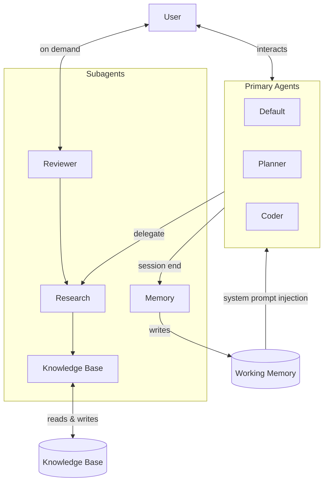

# vibe-ai-agent-harness

A multi-agent AI coding assistant harness with persistent memory and a self-updating knowledge base.

## Philosophy

AI sessions start cold. The goal of this harness is to make that a non-issue — context is persisted so you can start a new session at any time without re-establishing what you were doing or what the agent should know.

Agents are specialized and narrow. Each does one thing well — the UNIX philosophy applied to AI. Narrow scope means smaller context, cleaner instructions, and compatibility with smaller models. The system is designed so that even lightweight models can perform well in focused roles.

The system is model-agnostic. Models are the brain — swappable at any time without changing the logic. No vendor lock-in.

## System



## Agents

| Agent | Type | Role |
|---|---|---|
| Default | Primary | Main interaction — research, memory, general coding tasks |
| Planner | Primary | Creates structured plans before implementation begins; every plan carries an ACCEPTANCE.md defining done |
| Coder | Primary | Executes plans or ad-hoc coding requests; writes tests first, self-verifies with the standard validation pipeline |
| Research | Subagent | Investigates topics; checks knowledge base before going external |
| Knowledge Base | Subagent | Reads and writes the zettelkasten knowledge base |
| Memory | Subagent | Evaluates conversation transcripts and extracts memory items |
| Reviewer | Subagent | Blunt code reviews; independently validates tests encode acceptance criteria |

## Memory & Knowledge Base

The harness uses two persistence layers with different purposes.

**Working memory** is a short-term context store — a flat markdown file capped at 100 items. It holds recent decisions, completed work, and research runs, each tagged with `[decision]`, `[work]`, `[research]`, or `[kb-enrichment]`. At the start of every session it is injected into the system prompt, giving the primary agent immediate context. At the end of each session, the plugin automatically evaluates the conversation and passes it to the memory agent, which extracts significant items and appends them to the file. Autonomous agent sessions (enrichment, maintenance) are skipped. The oldest items are pruned when the cap is reached.

**The knowledge base** is a zettelkasten — a graph of atomic markdown notes linked to each other. It is the long-term source of truth. When an agent needs to learn something new, it researches it and writes it into the knowledge base. The knowledge base agent acts as the gatekeeper — all reads and writes go through it.

## Orchestration CLI (`boy`)

`boy` runs a coder in the background, in its own git worktree, through the opencode server you already have running. A coder works either a finished plan or an ad-hoc prompt. It is installed to `~/.local/bin/boy` by `./install.sh` (which needs `go` on your PATH).

```bash
boy start --plan .agents/plans/<plan>    # worktree + branch <plan> under .agents/worktrees/, then start a coder
boy start "fix the typo in login.go"     # ad-hoc coder: worktree + branch adhoc-<slug>-<hash>
boy start                                # in a terminal: pick plan or ad-hoc, then a plan or a prompt
boy prompt [--steer] <session-id> "<text>"   # send a follow-up to a running or idle coder, from any directory
boy status [--dir <repo> | --all | -A] [<session-id>]   # one row per coder
boy remove [--force] <session-id>        # remove the worktree and session once the branch is merged
```

`start`, `status` and `prompt` print a table by default and JSON with `-o json` (or `--output json`):

```
SESSION        STATE    TASKS  BRANCH                        AGE    IN STATE  TITLE
ses_abc        running  2/5    20-adhoc-coders               5m0s   4m0s      Implement plan 20
ses_def        idle     -      adhoc-fix-the-typo-in-1a2b3c  4m50s  3m20s     Fix the typo
```

`--all` adds a `REPO` column. `TASKS` is `-` for an ad-hoc coder. In JSON each entry has `session`, `repo`, `worktree`, `title`, `plan`, `branch`, `tasks`, `state`, `outcome` and timing fields; `plan` and `tasks` are `null` for an ad-hoc coder.

- A plan must be committed and live directly under `.agents/plans/` of a main checkout (archived plans and plans inside worktrees are not started). `--plan` takes the plan's path and works from any directory, so `start` has no `--dir`.
- A coder's name is its worktree directory and its branch: the plan's name, or `adhoc-<slug>-<hash>` for a prompt. Every ad-hoc `start` makes a new coder; send changes to an existing one with `prompt`.
- `start --plan` is safe to repeat: it reports a running coder, resumes an idle one that has tasks left, and does nothing for a finished one.
- `prompt` queues the text behind the coder's current turn, or redirects the current turn with `--steer`. It never interrupts. A follow-up on a plan is for fixes; a change to the spec goes back through the planner.
- The coder commits when its pipeline is green and never pushes. You merge the branch; `remove` refuses to delete an unmerged or dirty worktree without `--force`, and keeps the branch.
- The coder records its decisions in `.agents/DECISIONS.md` in its worktree. The file is a temporary record of that run: add `.agents/DECISIONS.md` to the repo's `.gitignore` so it is never committed, and read it before `remove` deletes the worktree.
- `boy` only attaches to a server, it never starts one. It finds the server in opencode's `~/.local/state/opencode/service.json`. `server_url` and `server_password` in `~/.config/boy/config.yaml` override that, and `BOY_SERVER_URL` / `BOY_SERVER_PASSWORD` override both.

## Getting Started

1. Edit `config.ts` to set your paths and preferred model profile
2. Run `./install.sh` to render and install

```bash
./install.sh                                         # install with default profile
./install.sh --platform opencode --profile broke     # install with a different profile
./install.sh --dry-run                               # preview without writing
```
