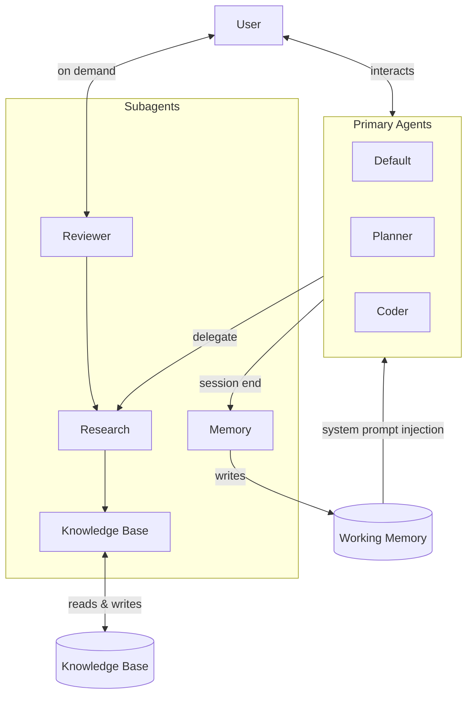

# vibe-ai-agent-harness

A multi-agent AI coding assistant harness with persistent memory and a self-updating knowledge base.

## Philosophy

AI sessions start cold. The goal of this harness is to make that a non-issue — context is persisted so you can start a new session at any time without re-establishing what you were doing or what the agent should know.

Agents are specialized and narrow. Each does one thing well — the UNIX philosophy applied to AI. Narrow scope means smaller context, cleaner instructions, and compatibility with smaller models. The system is designed so that even lightweight models can perform well in focused roles.

The system is model-agnostic. Models are the brain — swappable at any time without changing the logic. No vendor lock-in.

## System



## Agents

| Agent | Type | Role |
|---|---|---|
| Default | Primary | Main interaction — research, memory, general coding tasks |
| Planner | Primary | Creates structured plans before implementation begins; every plan carries an ACCEPTANCE.md defining done |
| Coder | Primary | Executes plans or ad-hoc coding requests; writes tests first, self-verifies with the standard validation pipeline |
| Research | Subagent | Investigates topics; checks knowledge base before going external |
| Knowledge Base | Subagent | Reads and writes the zettelkasten knowledge base |
| Memory | Subagent | Evaluates conversation transcripts and extracts memory items |
| Reviewer | Subagent | Blunt code reviews; independently validates tests encode acceptance criteria |

## Memory & Knowledge Base

The harness uses two persistence layers with different purposes.

**Working memory** is a short-term context store — a flat markdown file capped at 100 items. It holds recent decisions, completed work, and research runs, each tagged with `[decision]`, `[work]`, `[research]`, or `[kb-enrichment]`. At the start of every session it is injected into the system prompt, giving the primary agent immediate context. At the end of each session, the plugin automatically evaluates the conversation and passes it to the memory agent, which extracts significant items and appends them to the file. Autonomous agent sessions (enrichment, maintenance) are skipped. The oldest items are pruned when the cap is reached.

**The knowledge base** is a zettelkasten — a graph of atomic markdown notes linked to each other. It is the long-term source of truth. When an agent needs to learn something new, it researches it and writes it into the knowledge base. The knowledge base agent acts as the gatekeeper — all reads and writes go through it.

## Orchestration CLI (`boy`)

`boy` runs coders in the background, each in its own git worktree under `.agents/worktrees/`, through the opencode server you already have running. It is installed to `~/.local/bin/boy` by `./install.sh` (which needs `go` on your PATH).

```bash
boy start [--dir <repo>] [--plan <path> | "<prompt>"]   # a plan coder (branch <plan>) or an ad-hoc coder (branch adhoc-<slug>-<hash>), then start it
boy prompt [--steer] <session-id> <text>                # send a follow-up to an idle or running coder
boy status [--dir <repo> | --all | -A] [<session-id>]   # the coders as a table: state, tasks, branch, age
boy remove [--force] <session-id>                       # remove the worktree and session once the branch is merged
```

- Run `start` with no arguments on a terminal and it opens a picker: choose an active plan or type an ad-hoc prompt.
- A plan must be committed and live directly under `.agents/plans/` (archived plans are not started).
- `start` is safe to repeat: it reports a running coder, resumes an idle one that has tasks left, and does nothing for a finished one.
- `prompt` sends follow-ups to a coder: straight away while it is idle, queued while it is running, or steered into the running turn with `--steer`. It never interrupts.
- Coders run unattended: they record decisions in a gitignored `.agents/DECISIONS.md` in their worktree, commit once the validation pipeline is green, and never push. You merge the branch; `remove` refuses to delete an unmerged or dirty worktree without `--force`, and keeps the branch.
- Output is a human table by default; `-o json` (on `start`, `status` and `prompt`) prints machine-readable JSON instead.
- `boy` only attaches to a server, it never starts one. It finds the server in opencode's `~/.local/state/opencode/service.json`. `server_url` and `server_password` in `~/.config/boy/config.yaml` override that, and `BOY_SERVER_URL` / `BOY_SERVER_PASSWORD` override both.

## Getting Started

1. Edit `config.ts` to set your paths and preferred model profile
2. Run `./install.sh` to render and install

```bash
./install.sh                                         # install with default profile
./install.sh --platform opencode --profile broke     # install with a different profile
./install.sh --dry-run                               # preview without writing
```
